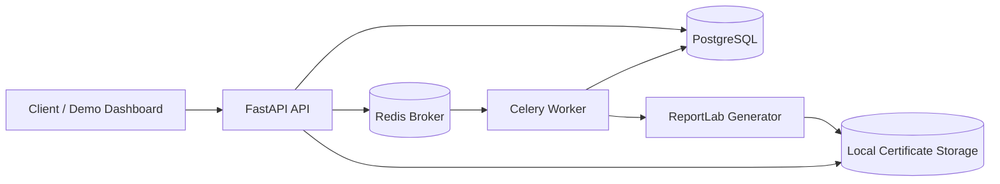

# Bulk Certificate Generator

Backend API for creating bulk certificate generation jobs, processing them asynchronously, tracking progress, and downloading generated PDF certificates.

The project is intentionally production-minded but interview-friendly: FastAPI handles HTTP, PostgreSQL stores job state, Redis + Celery process long-running work, ReportLab renders PDFs, and local filesystem storage keeps generated files outside the database.

## Features

- Bulk job creation with one request for many recipients
- Independent recipient validation so bad rows do not reject the whole batch
- Asynchronous processing with Celery and Redis
- Database-backed job progress and per-recipient status
- Per-recipient failure isolation
- Single predefined professional ReportLab PDF template
- Safe local certificate storage with UUID file paths
- Paginated job and recipient APIs
- Certificate download endpoint
- Health checks for liveness and readiness
- Request ID middleware and consistent error responses
- Alembic migrations, Docker Compose, tests, linting, and documentation

## Architecture



The database is the source of truth for job progress. Celery task state is not exposed to clients because worker result backends are not a durable product-facing status model.

## Tech Stack

- **FastAPI**: modern Python API framework with OpenAPI docs.
- **PostgreSQL**: relational source of truth for jobs, recipients, and progress.
- **SQLAlchemy 2.x**: explicit ORM model and session management.
- **Alembic**: database migrations.
- **Redis**: Celery broker.
- **Celery**: durable asynchronous background processing.
- **ReportLab**: PDF certificate generation.
- **Pydantic v2 / pydantic-settings**: request models and environment configuration.
- **Pytest / HTTPX**: unit and integration testing.

## Setup

```bash
python -m venv .venv
.venv\Scripts\activate  # Windows
python -m pip install -e ".[dev]"
copy .env.example .env
```

Update `.env` if your PostgreSQL or Redis connection differs.

## Docker Setup

The easiest full-system run is Docker Compose:

```bash
docker compose up --build
```

This starts:

- API at `http://localhost:8000`
- PostgreSQL at `localhost:5432`
- Redis at `localhost:6379`
- Celery worker sharing the certificate storage volume

OpenAPI docs:

- `http://localhost:8000/docs`
- `http://localhost:8000/redoc`

## Database Migration

```bash
alembic upgrade head
```

Migration files live in `alembic/versions`. The first migration creates the `jobs` and `recipients` tables, enums, indexes, and constraints.

## Run API Locally

```bash
uvicorn app.main:app --reload
```

## Run Worker Locally

```bash
celery -A app.workers.celery_app.celery_app worker --loglevel=info
```

## Run Tests

```bash
pytest
```

The default tests use SQLite, fake queueing, dependency overrides, and temporary certificate storage. They do not require a live PostgreSQL or Redis server.

## Lint and Format

```bash
ruff check .
ruff format --check .
```

## API Usage

Create a generation job:

```bash
curl -X POST http://localhost:8000/api/v1/jobs \
  -H "Content-Type: application/json" \
  -d '{
    "organization_name": "ABC Learning",
    "certificate_title": "Certificate of Completion",
    "event_name": "Advanced AI Workshop",
    "issue_date": "2026-10-07",
    "recipients": [
      {
        "full_name": "Alice Johnson",
        "email": "alice@example.com",
        "course_name": "Generative AI",
        "external_id": "STU-001"
      },
      {
        "full_name": "Bob Smith",
        "email": "bob@example.com",
        "course_name": "Generative AI",
        "external_id": "STU-002"
      },
      {
        "full_name": "",
        "email": "not-an-email",
        "course_name": "",
        "external_id": "BAD-ROW"
      }
    ]
  }'
```

Example response:

```json
{
  "job_id": "5aa1f9b9-8d7d-4c1f-a4af-7d8a5172c610",
  "status": "QUEUED",
  "total_recipients": 3,
  "valid_recipients": 2,
  "invalid_recipients": 1,
  "status_url": "/api/v1/jobs/5aa1f9b9-8d7d-4c1f-a4af-7d8a5172c610"
}
```

Check status:

```bash
curl http://localhost:8000/api/v1/jobs/<JOB_ID>
```

Example response:

```json
{
  "job_id": "5aa1f9b9-8d7d-4c1f-a4af-7d8a5172c610",
  "organization_name": "ABC Learning",
  "certificate_title": "Certificate of Completion",
  "event_name": "Advanced AI Workshop",
  "issue_date": "2026-10-07",
  "status": "COMPLETED_WITH_ERRORS",
  "total_recipients": 3,
  "valid_recipients": 2,
  "invalid_recipients": 1,
  "success_count": 2,
  "failure_count": 0,
  "processed_count": 3,
  "progress_percent": 100.0,
  "created_at": "2026-10-07T10:00:00Z",
  "started_at": "2026-10-07T10:00:02Z",
  "completed_at": "2026-10-07T10:00:03Z",
  "error_message": null
}
```

List recipients:

```bash
curl "http://localhost:8000/api/v1/jobs/<JOB_ID>/recipients?page=1&page_size=50"
```

Download a certificate:

```bash
curl \
  http://localhost:8000/api/v1/jobs/<JOB_ID>/recipients/<RECIPIENT_ID>/certificate \
  --output certificate.pdf
```

## Important Design Decisions

- **Asynchronous processing** keeps HTTP requests fast and prevents large PDF batches from tying up API workers.
- **Database-backed status** makes progress durable and queryable even if workers restart.
- **Recipient-level validation** accepts mixed-quality bulk files and preserves per-row validation errors.
- **Failure isolation** catches certificate/storage failures per recipient and continues the batch.
- **Local storage** is simple for a take-home project, while the storage protocol can later be backed by S3.
- **UUID paths** prevent user-controlled filenames from influencing filesystem access.
- **Pagination** prevents large jobs from returning thousands of rows in one response.
- **Authentication is out of scope** for the assignment. Production deployments should add OAuth, JWT, API keys, or another suitable auth layer.

## Demo Dashboard

A small optional Vite/React/Tailwind demo lives in `dashboard/`. It is intentionally lightweight and consumes only the public API endpoints.

```bash
cd dashboard
npm install
npm run dev
```

## More Documentation

- `docs/architecture.md`
- `docs/api.md`
- `docs/database.md`
- `docs/decisions.md`
- `docs/screens.md`
- `docs/interview.md`
