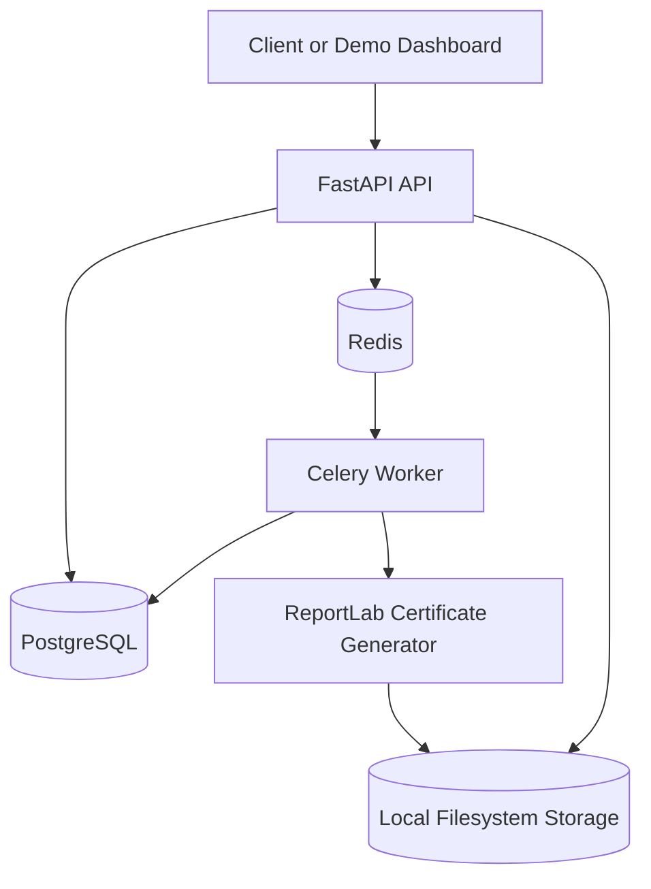

# Architecture

## Component Diagram



## Request Lifecycle

1. Client submits `POST /api/v1/jobs`.
2. FastAPI validates job-level fields.
3. The service checks `MAX_RECIPIENTS`.
4. Each recipient is validated independently.
5. A job row and all recipient rows are committed atomically.
6. The committed job ID is enqueued to Celery.
7. The API returns `202 Accepted` with the job ID and status URL.

The commit happens before enqueueing so the worker never tries to read uncommitted rows.

## Certificate Generation Lifecycle

1. Worker loads the job with its own SQLAlchemy session.
2. Job moves from `QUEUED` to `RUNNING`.
3. Worker fetches `PENDING` recipients in `PROCESS_BATCH_SIZE` batches.
4. Each recipient is marked `PROCESSING`.
5. ReportLab renders the PDF from the fixed template.
6. The storage service atomically writes the file under `storage/certificates/<job_id>/<recipient_id>.pdf`.
7. Recipient metadata and status move to `SUCCESS`.
8. Failures move only that recipient to `FAILED`.
9. Final job status becomes `COMPLETED` or `COMPLETED_WITH_ERRORS`.

## Failure Handling

Invalid recipients are marked `INVALID` during job creation and are never sent to the generator.

Worker processing wraps each recipient in its own `try/except`. A renderer or storage failure marks that recipient `FAILED`, recalculates counters, logs the exception, and continues with the next recipient.

`FAILED` job status is reserved for system-level failures, such as a worker failure that prevents normal processing.

## Database Interaction

The API uses request-scoped sessions. The Celery worker creates and closes its own sessions. Certificate generation does not hold a long database transaction open; each recipient state transition is committed independently.

## Storage Strategy

PDF bytes are stored on disk, not in PostgreSQL. The database stores only safe metadata: relative path, filename, size, and certificate number.

Local storage is appropriate for a take-home project and Docker Compose. A production deployment could implement the same `StorageService` protocol with S3 or another object store.

## Why Celery

Certificate generation may involve hundreds or thousands of PDFs, filesystem I/O, and individual failures. Celery gives a dedicated worker process, retry hooks, operational isolation from API workers, and a natural path to horizontal scaling.

FastAPI `BackgroundTasks` are useful for very small best-effort tasks, but they run inside the API process and are not a durable queue.

## Why Redis

Redis is a simple, common Celery broker. It keeps this project easy to run locally while still representing a real asynchronous architecture.

## Why PostgreSQL

Jobs and recipients are relational data with clear ownership, status queries, indexes, and transactional creation requirements. PostgreSQL also gives JSONB for validation errors and robust UUID support.

## Why Local Storage

Local storage avoids requiring cloud credentials for a take-home assignment. The path strategy mirrors object storage keys, so replacing it with S3 later is straightforward.

## How It Could Scale

Current design:

```text
One job -> one Celery task -> recipients processed in batches
```

Future high-scale design:

```text
API
 |
 v
Job created
 |
 v
Chunking task
 |
 +----------+----------+----------+
 |          |          |          |
 v          v          v          v
Chunk 1   Chunk 2   Chunk 3   Chunk 4
 |          |          |          |
 v          v          v          v
Worker    Worker    Worker    Worker
```

Future additions could include object storage, presigned URLs, worker autoscaling, dead-letter queues, retry policies, metrics, distributed tracing, cancellation, rate limiting, and notifications.
