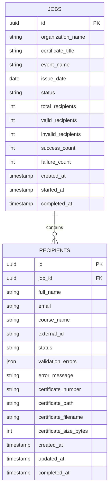

# Database Design

## ER Diagram

## Tables

### jobs

Stores one submitted bulk request and aggregate counters.

Important fields:

- `id`: UUID primary key and public job identifier.
- `status`: `QUEUED`, `RUNNING`, `COMPLETED`, `COMPLETED_WITH_ERRORS`, or `FAILED`.
- `total_recipients`, `valid_recipients`, `invalid_recipients`: submission counts.
- `success_count`, `failure_count`: generation counts.
- `started_at`, `completed_at`: worker lifecycle timestamps.

### recipients

Stores one recipient row in a job.

Important fields:

- `id`: UUID primary key and public recipient identifier.
- `job_id`: foreign key to `jobs`.
- `status`: `PENDING`, `PROCESSING`, `SUCCESS`, `FAILED`, or `INVALID`.
- `validation_errors`: recipient-level validation errors for invalid rows.
- `certificate_path`: relative storage path, never user-provided.
- `certificate_number`: human-readable certificate ID.

## Indexes

- `jobs(status)`
- `jobs(created_at)`
- `recipients(job_id)`
- `recipients(job_id, status)`
- `recipients(job_id, external_id)`
- unique `recipients(certificate_number)`

## Transaction Boundaries

Job creation inserts the job and all recipient rows in one transaction. If insertion fails, no partial job is committed.

Worker processing commits state progressively per recipient. It does not keep one large transaction open while generating many PDFs.

## Why PDFs Are Not Stored in PostgreSQL

PDFs are binary blobs and can grow quickly. Keeping them outside the database makes backups, query performance, and storage scaling simpler. PostgreSQL stores metadata and status; local or object storage stores the file bytes.

## Time Handling

`issue_date` is stored as a date because it is business data printed on certificates. Operational timestamps are timezone-aware and treated as UTC.
